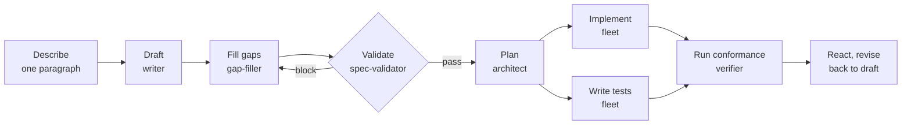

# specd

**Vibe spec for POCs.** Describe what you want; an agent drafts the spec, a second
fills the gaps, a third validates it. An architect then plans the build, and a
fleet implements it and writes the conformance tests. No interview, no approval
meeting, no runtime.

Specs are plain Markdown. There is no runtime, build step, or parser. The seed
works with GitHub Copilot out of the box, and with any agent that reads
[`AGENTS.md`](AGENTS.md).

## The problem

Interview-first spec tools are too slow for a POC. They ask the user to answer
abstract questions before there is anything to react to, then treat the answers as
a contract. The user spends an hour on a questionnaire and the spec is still wrong
in the places that matter.

A POC needs the opposite: a short description, a fast draft, labelled guesses, and
a gate that catches the dangerous ones.

## The loop



| Step | Who | Output |
|---|---|---|
| Describe | user | a paragraph in `## Source` |
| Draft | `spec-writer` | `specs/system/<id>.md`, draft |
| Fill gaps | `gap-filler` | repo profile, assumptions, decisions, conflicts |
| Validate | `spec-validator` | `## Validation`, `status: validated` |
| Plan | `architect` | `plans/<id>.md` with file map, tracks, test strategy |
| Implement + write tests | `implementer` + `verifier` (fleet) | code and conformance tests, disjoint files |
| Run conformance | `verifier` | pass / fail / blocked per `REQ-` |

## Before you start

- **Git.**
- **One agent surface:**
  - GitHub Copilot in VS Code (custom agents, prompt files, skills);
  - GitHub Copilot CLI/app (custom agents, `/fleet`);
  - any agent that reads `AGENTS.md` (DSH, Claude Code, Cursor, ...).
- **A shell** for the validator's canonical hash. Without one, the validator
  cannot bind a validation to the file.
- **A repository to build in.** The seed is the starting point; clone it or copy
  the files into an existing repo.

Specs are inputs to agents. Do not paste credentials, private endpoints, or
untrusted instructions into a spec.

## Quick start

### 1. Get the seed

```bash
git clone https://github.com/wy900416/specd.git my-poc
cd my-poc
```

Or click **Use this template** on GitHub and clone your copy.

### 2. Open it with an agent

| Surface | What to do |
|---|---|
| VS Code + Copilot | Open the folder, open Copilot Chat, select the `specd` agent, and paste the description. If the picker does not show it, reload the window or run `/new-spec`. |
| Copilot CLI/app | Start in the folder and describe the product. Custom agents are in `.github/agents/`; `/fleet` is available for implementation. |
| Any other agent | Say: "Read `AGENTS.md` and follow `agents/orchestrator.md`." |

### 3. Describe the product

> Build a URL shortener for a small internal team. Links expire after 30 days, and
> I want a simple web page plus an API.

### 4. Check the result

The agent writes `specs/system/url-shortener.md` and reports:

- the requirements;
- the assumptions it made;
- any fenced high-risk fact;
- the validation result.

There is no approval step. If validation blocks, read `## Validation` in the spec;
the blocking list names the exact fix.

### 5. Implement

Say **implement**. The architect writes `plans/url-shortener.md` first, then the
fleet implements the code and writes the conformance tests in parallel.

To read the plan before any code is written:

```text
/plan-implementation specs/system/url-shortener.md
```

then:

```text
/implement specs/system/url-shortener.md
```

## What a spec looks like

```md
### REQ-SYS-001: Shorten a valid URL

- **Priority:** must
- **Normative:** true
- **Source:** user
- **Given:** a user submits an absolute `http` or `https` URL
- **When:** they call the shorten endpoint
- **Then:** the response contains a short code that resolves to the same URL
```

Every guess is visible:

```md
## Assumptions

| # | Assumption | Basis | Risk | Confirmed | Revisit |
|---|---|---|---|---|---|
| 1 | Links are internal-only | no public sharing mentioned | medium | no | first feedback |
```

## What is in the box

```
AGENTS.md                 cross-tool agent entry point
SPEC.md                   format and lifecycle, normative
.github/
  copilot-instructions.md always-on rules
  instructions/           path-scoped rules (specs/**)
  agents/                 specd orchestrator + role specialists
  prompts/                new-spec, fill-gaps, validate-spec, check-conflicts,
                          plan-implementation, implement, build-index
agents/                   role briefs (source of truth)
.agents/skills/           spec-draft, spec-gap-fill, spec-validate, spec-context
checklists/               validate, context, review, plan
templates/                system + plan + contract-stage kinds
docs/                     vibe-spec, index, POC mode, contract mode, fleet
specs/                    empty; your specs land here
plans/                    implementation plans from the architect
examples/demo-shop/       reference graph, outside validation
changes/                  contract-stage proposals only
```

## Aggressive inference: one brake, one fence

The gap-filler may choose the stack, naming, structure, data shapes, defaults, and
POC simplifications. It records each choice with a basis, a risk, and a revisit
trigger. It does not ask "which database?" unless the answer changes something
expensive.

**One brake: conflicts.** A contradiction with an existing spec goes to
`## Conflicts` with options; the user chooses. An open conflict blocks validation.

**One fence: high-risk facts.** Security, privacy, data ownership, pricing, legal,
compliance, and breaking public contracts may be inferred for a POC, but they are
fenced: `Risk: high`, `Confirmed: agent (POC)`, `Revisit: before production`, fake
data, no real users, money, or PII. The validator reports them as warnings; they
do not block the POC, and they must be confirmed before promotion.

## Validation, not approval

There is no human approval step in the POC stage. The `spec-validator` agent
applies [`checklists/validate.md`](checklists/validate.md) and is the only role
allowed to set `status: validated`.

- The validator runs in a separate context and does not read the writer's
  rationale.
- It records a result per check, with findings at `file:line`.
- It binds the validation to a content hash (`validated_sha`).
- Any semantic edit demotes the spec to `draft` and clears the hash.

That is a stricter gate than "looks good to me", without a meeting.

## Copilot and other agents

| Surface | Path |
|---|---|
| Always-on instructions | `.github/copilot-instructions.md` |
| Path instructions | `.github/instructions/*.instructions.md` |
| Selectable agents | `.github/agents/*.agent.md` |
| Slash commands | `.github/prompts/*.prompt.md` |
| Skills | `.agents/skills/*/SKILL.md` (auto-discovered) |
| Cross-tool entry | `AGENTS.md` |

Custom agents use `.github/agents/*.agent.md`; the older
`.github/chatmodes/*.chatmode.md` format has been superseded. Skills live in
`.agents/skills/` and are auto-discovered.

The role briefs in `agents/` are the source of truth. The Copilot files are thin
wrappers, so the same procedure works in DSH, Claude Code, Cursor, or a custom
loop.

### Which agent?

| Task | Agent | Why |
|---|---|---|
| New spec, end to end | `specd` | routes writer -> gap-filler -> validator |
| Draft only | `spec-writer` | no gap-fill or validation |
| Fill gaps on an existing draft | `gap-filler` | repo + global-skill inference |
| Validate only | `spec-validator` | independent gate; sets `validated` |
| Plan implementation | `architect` | architecture, file map, tracks, test strategy |
| Implement a planned track | `implementer` | one disjoint file set |
| Conformance tests | `verifier` | tests from the spec, not the code |
| Contract-stage review | `spec-reviewer` | graph consistency and version hygiene |
| Several independent specs | `/fleet` + `specd` or `spec-writer` per file | disjoint files only |
| Implementation + tests | `/fleet` + `implementer` / `verifier` per track | plan must be ready first |

You do not need to switch agents for the normal flow: select `specd` once, or run
`/new-spec`. Switch manually when you want to force a role, such as a second
independent validation or a draft-only pass.

### Prompt reference

Prompt files live in `.github/prompts/` and work in VS Code, Visual Studio, and
JetBrains. In Copilot CLI/app, describe the same step in natural language and name
the agent.

| Command | Input | What it does |
|---|---|---|
| `/new-spec` | a description | draft, gap-fill, validate |
| `/fill-gaps` | spec path | repo profile, assumptions, decisions, conflicts |
| `/validate-spec` | spec path | `## Validation`, sets `status: validated` |
| `/check-conflicts` | spec path | writes `## Conflicts` for the user to resolve |
| `/plan-implementation` | spec path | `plans/<id>.md` with architecture, tracks, tests |
| `/implement` | spec path | fleet implementation and conformance tests |
| `/build-index` | none | `specs/INDEX.md` when the trigger is met |

The gap-filler also reads the user's installed global skills, if the runtime
exposes them:

```
~/.copilot/skills/*/SKILL.md
~/.agents/skills/*/SKILL.md
~/.claude/skills/*/SKILL.md
```

Read-only. It cites `global-skill:<name>` and never copies their content into the
spec.

## Implementation: plan → fleet

A validated spec is not an implementation plan. The architect designs the
architecture and the parallel work first.

### 1. Produce the plan

```text
/plan-implementation specs/system/url-shortener.md
```

The plan lives at `plans/url-shortener.md` and contains:

- **Decision:** build, build a slice, or wait;
- **Architecture** and data flow;
- **File map:** one owner per file;
- **Work tracks:** disjoint files, dependencies, done when;
- **Test strategy:** every in-scope `REQ-` mapped to a test file;
- **Risks and fences** carried from the spec.

The plan is bound to the spec's canonical hash (`spec_sha`). If the spec changes,
the plan is `stale` and must be re-planned.

### 2. Run the fleet

```text
/implement specs/system/url-shortener.md
```

Or, with `/fleet` in Copilot CLI/app:

```text
/fleet Implement plans/url-shortener.md.

Tracks:
1. T1 core — src/shorten/**, tests/unit/shorten/** — @implementer.agent.md
2. T2 API — src/api/**, tests/api/** — @implementer.agent.md
3. V1 conformance — tests/conformance/shorten.test.ts — @verifier.agent.md

Run T1, T2, V1 in parallel; the files are disjoint.
If the plan has a setup track, run it first.
After all finish, run `pnpm test` and report each REQ as pass/fail/blocked.
```

### 3. What runs in parallel

- **Setup first:** dependencies, lockfile, shared config, schema, test config.
- **Implementation tracks and verifier test tracks in parallel.** Each owns
  disjoint files.
- **Tests run after both land.** The verifier writes from the spec and the
  `## Test Strategy`, not from the implementation.
- **The verifier never grades the implementer's own tests.**

### 4. Read the result

The verifier reports one row per in-scope `REQ-`: pass, fail, or blocked. Each
failure is classified as a **code bug**, a **spec ambiguity**, or a **harness
issue**. The plan is `done` only when every in-scope `REQ-` passes.

### 5. When not to fleet

If the plan has only one track total, run the implementer, then the verifier.
Fleet is for disjoint work, not for a single file.

Full rules and prompt patterns: [`docs/fleet.md`](docs/fleet.md).

## No index by default

A fresh seed has one to ten specs; reading them all is cheap. Add
`specs/INDEX.md` only when one of these is true:

- more than 20 specs;
- more than 3 owners;
- a full read no longer fits the context budget;
- conflict detection missed a real conflict twice;
- a deterministic CI step needs one entry point.

The index is derived from front-matter and never the source of truth. Full policy:
[`docs/index.md`](docs/index.md).

## Contract stage

When another team, an external consumer, or real money/PII depends on the spec,
promote it to `stage: contract`. Then version, human approval, and proposals start
to pay for themselves. See [`docs/contract-mode.md`](docs/contract-mode.md).

## Adopt in an existing repository

1. Copy `AGENTS.md`, `SPEC.md`, `.github/`, `agents/`, `.agents/skills/`,
   `checklists/`, `templates/`, and `docs/` into your repository.
2. Create `specs/` and `plans/`; empty directories are fine.
3. **Merge, do not overwrite.** Keep your existing `README`, `AGENTS.md`,
   `.github/copilot-instructions.md`, CI, and test config. Add the specd sections
   to them instead of replacing them.
4. Describe the change in the new repo. The writer profiles your stack,
   conventions, and existing specs.
5. Run `/check-conflicts` if you already have specs; the user resolves any
   conflict.
6. Validate, plan, implement.

If the repository already has specs, keep them. The writer scans front-matter for
ids and the gap-filler scans for conflicts.

## Change a validated spec

1. Say what changed, in one message.
2. The writer or gap-filler edits the spec and sets `status: draft`; the
   `validated_*` fields are cleared.
3. The validator re-runs and records a new canonical hash.
4. The plan becomes `stale`; re-run `/plan-implementation` before more code.
5. The user reacts to the running product; repeat.

In the POC stage, do not route an edit through a proposal. Proposals and semver
start at contract stage.

## Troubleshooting

| Symptom | Fix |
|---|---|
| `specd` is not in the agent picker | Reload the window. Confirm `.github/agents/specd.agent.md` exists. Use `/new-spec` as a fallback. |
| `/fleet` is missing | `/fleet` is a Copilot CLI/app command. In VS Code, use the custom agents and subagents, or run `/plan-implementation` then `/implement`. |
| Prompt files do not appear on github.com | Prompt files are an IDE surface. Use the custom agents there, or describe the step. |
| The gap-filler found no global skills | Normal. It records "not accessible" in `## Repo Profile` and continues. |
| Validation is blocked | Read `## Validation`; the blocking list names the fix. Common: a requirement has no `Source`; a user-reserved fact is still `needs-human`; a conflict is open; the hash is stale. |
| The version is still `0.1.0` | Intentional in `stage: poc`. Semver starts at contract promotion. |
| The plan says `stale` | The spec changed. Re-run `/plan-implementation`; do not reuse the old file map. |
| Two agents overwrote each other | The plan assigned one file to two tracks. Fix the file map, then re-run. |
| The spec is too large | Keep one system spec; split only on evidence. See [`docs/one-big-spec.md`](docs/one-big-spec.md). |
| I want a human approval gate | The seed has none by design. Add your own review step; the validator and the plan are the built-in gates. |

## Design decisions

| Decision | Why | Cost |
|---|---|---|
| Describe, don't interview | The first useful answers come from a running product | The draft may be thin; labels expose it |
| Agent validation instead of human approval | Speed without silent invention | A checklist can miss a product mistake |
| Plan before fleet | Parallel agents need disjoint files and a complete test map | One architect step |
| Aggressive, labelled inference | The user reacts to a default faster than to a question | More assumptions to review |
| High-risk facts are fenced | A POC can test with fake data without guessing production policy | Must be confirmed before promotion |
| `version` stays `0.1.0` in POC | A version that changes on every edit means nothing | Contract stage must start semver |
| One `system` spec first | Boundaries are hypotheses at POC stage | Split later on evidence |
| Separate validator | The writer cannot grade its own work | One more run |
| Global skills read-only | Preferences inform the stack; they are not requirements | Fewer personal details copied |
| No index until scale | A second list drifts | Agents read all specs while small |
| Plain Markdown | Portable, diffable, no runtime | No automated lint |

## Learn more

- [`docs/vibe-spec.md`](docs/vibe-spec.md) — why the interview is not the default.
- [`docs/poc-mode.md`](docs/poc-mode.md) — inference, assumptions, and high-risk
  facts.
- [`docs/index.md`](docs/index.md) — when an index earns its keep.
- [`docs/fleet.md`](docs/fleet.md) — when parallel subagents help, and when they
  corrupt the work.
- [`SPEC.md`](SPEC.md) — the normative format.
- [`AGENTS.md`](AGENTS.md) — the agent entry point.

## What this is not

- Not a formal language. Prose is allowed; structure exists to expose gaps.
- Not a build system. There is no parser, generator, or CI requirement.
- Not a guarantee. Validation catches what the checklist can name, not whether the
  product is worth building.
- Not an interview. The user describes once; the agent infers until a
  user-reserved fact or a conflict forces a question.
