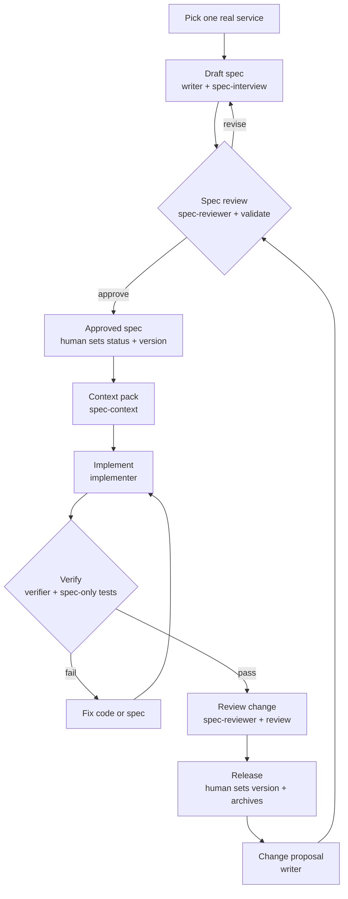

# specd

Spec-driven development in **plain Markdown**. No runtime, no build step, no
parser. A spec is a file; the graph is typed links; the agent is whatever chat or
coding agent you already use.

This repository is the framework and a small demo graph. It is deliberately not a
tool: the format is the product.

## The problem

Most spec systems fail in one of five ways:

- the spec is a **document**, not a graph, so nobody knows what depends on what;
- the **version** is an edit counter, so every typo churns every reference;
- the agent **grades its own work**, so tests describe the implementation instead
  of the spec;
- the agent **invents answers silently**, so nobody knows which decisions were
  human;
- the **tooling becomes the product**, and the spec format is locked to it.

This framework is a response to those five failures.

## How the framework is used



| # | Step | Who | Output | Done when |
|---|---|---|---|---|
| 0 | Adopt | human | framework files in a real repo | one product boundary selected |
| 1 | Draft | writer + `spec-interview` | `specs/system/<id>.md` (POC) or a small set | checklist passes, agent decisions recorded, open questions have owners |
| 2 | Approve | human | approved spec | `status`, `approved_by`, `approved_at`, `version` set; agent decisions accepted or overridden |
| 3 | Context | `spec-context` | `.context/<id>.md` | manifest lists included, excluded, warnings |
| 4 | Implement | implementer | code + developer tests | tests pass, `REQ-ID`s cited in the change |
| 5 | Verify | verifier | conformance report | every in-scope `REQ` is pass, fail, or blocked |
| 6 | Review | spec-reviewer | review packet | blocking findings resolved, bump checked |
| 7 | Release | human | new version | base version matches, bump correct, proposal archived |
| 8 | Change | writer | `changes/CHG-...md` | proposal reviewed and released |

### Start with one big spec, split on evidence

For a POC, write **one `system` spec** for the whole product: problem, actors, main
flow, non-goals, requirements. If there is one deployable unit, add one `service`
spec. Do not create one spec per service on day one.

Why: at POC stage the boundaries are hypotheses. Splitting now freezes a guess into
a contract and multiplies the places to be inconsistent. See
[`docs/one-big-spec.md`](docs/one-big-spec.md).

Split when a seam is real: two teams, independent deploy, an external consumer, a
different change cadence, or a boundary that survived two changes. Add a **flow**
when a behaviour genuinely crosses two services; it is the only artifact that owns
cross-service behaviour.

### Keep the three loops separate

- **Spec loop**: draft -> review -> approve.
- **Implementation loop**: context -> implement -> verify.
- **Change loop**: proposal -> review -> release.

They share files, but they have different gates. Mixing them is how "the agent
updated the spec" becomes an unreviewed change.

## Why this design

| Decision | Why | Cost |
|---|---|---|
| Plain Markdown + YAML | Portable, diffable, readable by humans and agents; no runtime to install | No automatic validation |
| Typed links + stable ids | The system is a graph; impact, context, and ownership need edges | Link maintenance |
| Stable `REQ-` ids | Requirements can be cited by code, tests, and other specs | Id discipline |
| Draft vs approved | Agents can draft freely; published specs are a contract | Two-step workflow |
| Version only on release | Version communicates compatibility, not edit history | Human gate |
| Proposal as a full copy | Diff is derived; no special diff format; works with git | Duplication in `changes/` |
| Separate verifier | The implementer cannot define its own acceptance | One more handoff |
| One coarse spec first | Boundaries are hypotheses at POC stage; splitting freezes guesses | Must split later on evidence |
| Agent decisions recorded | POC speed without silent invention | Requires review; high-risk stays human |
| Human release | Accountability for breaking changes | Slower |
| Pinned standards | Some constraints must always be in context | Budget |
| Checklists, no linter | Portable; covers judgement, not only syntax | Manual, can drift |

### The graph is the end state

The graph is the **end state**, not day one. At POC stage, one `system` spec is
faster to write, fits one context, and is cheaper to change when user feedback
moves the product boundary.

A big spec is still written to be split: clear sections, stable `REQ-` ids, and
explicit non-goals. When a seam proves stable — two teams, independent deploy, an
external consumer — extract that section into its own spec and keep the ids. The
full rationale and split triggers are in
[`docs/one-big-spec.md`](docs/one-big-spec.md).

### The spec is a graph, not a document

At scale, a microservice system is not a tree. The same service is part of a domain, exposes
contracts, participates in flows, and is constrained by standards. A single
document per service cannot express those edges, and a folder cannot answer "who
consumes this contract?"

So every spec has a stable `id`, and every cross-spec statement is a typed link:
`implements`, `exposes`, `consumes`, `depends-on`, `constrained-by`, `part-of`.
The graph is what makes impact analysis, context packing, and orphan detection
possible without a central tool.

### The version is a release, not an edit

If every edit bumps the version, the version stops meaning anything and every
`id@version` reference churns. Here:

- an **edit** changes the file;
- a **release** changes the version;
- a **proposal** carries the intended change and the suggested bump;
- a **human** decides when the proposal becomes a release.

That is why agents never write `version`, `status: approved`, `approved_by`, or
`approved_at`. The proposal is a full copy of the target body, so the diff is
derived and reviewable with ordinary file tools.

### The verifier is not the implementer

If the same agent writes the code and the acceptance tests, the tests describe the
code. The verifier gets the spec, the acceptance criteria, and the test harness —
but not the implementer's plan or summary. It writes tests from the spec first.

This is an **information barrier**, not a different model. A fresh context is often
enough. The verifier's most valuable output is not "tests pass"; it is "this
requirement cannot be tested as written."

### Agent decisions are recorded, not hidden

A POC often stalls on a question the user has not decided. POC mode lets the agent
choose a reversible, low-risk default and keep moving. It does not let the agent
invent silently:

- the decision goes in `## Agent Decisions` with rationale, alternatives,
  reversibility, and a revisit trigger;
- the affected requirement is marked `**Decided by:** agent (POC)`;
- the review packet lists every agent decision;
- security, privacy, compliance, data ownership, pricing, legal, and breaking
  contracts stay human decisions.

Human approval accepts the draft, not the provenance. The next reader can still
see which decisions were human. The full rule is in
[`docs/poc-mode.md`](docs/poc-mode.md).

### The format is portable, not a tool

There is no parser, no index, no build, and no CI requirement. `SPEC.md` is
normative; `checklists/` is the operational form; `AGENTS.md` is the entry point.

The tradeoff is real: without a linter, validation is a checklist and a review, and
it can drift. If you later want a deterministic gate, add a read-only linter in CI.
It consumes the format; the format does not depend on it.

## Repository layout

```
SPEC.md                    format, kinds, links, lifecycle, versioning (normative)
AGENTS.md                  agent entry point and hard rules
GRAPH.md                   a view (Mermaid + table), not the source of truth
CHANGES.md                 proposal lifecycle
docs/
  one-big-spec.md          why one coarse spec first, when to split
  poc-mode.md              agent decisions, provenance, guardrails
checklists/
  validate.md              mechanical checks before approval
  context.md               bounded context packing
  review.md                judgement, severity, bump guide
templates/                 skeletons for each kind + a change proposal
specs/                     the graph; only specs live here
changes/                   open proposals; archive/ for released ones
.agents/skills/            plain-Markdown skills
agents/                    role briefs
```

## The spec format in 30 seconds

```yaml
---
id: orders
kind: service
title: "Orders Service"
version: 0.1.0
status: draft
owner: orders-team
links:
  - rel: implements
    target: commerce
  - rel: exposes
    target: orders-api
---
```

```md
### REQ-ORD-001: Create an order idempotently

- **Priority:** must
- **Normative:** true
- **Given:** a client submits the same `Idempotency-Key` twice
- **When:** both requests reach the service
- **Then:** exactly one order is created and both responses carry the same order id
```

The rest — kinds, required edges, lifecycle, version rules — is in
[`SPEC.md`](SPEC.md).

## Roles and handoff

```text
writer -> implementer -> verifier -> reviewer -> human release
```

| Role | Brief | Job |
|---|---|---|
| Writer | [`agents/spec-writer.md`](agents/spec-writer.md) | interview, draft, proposal |
| Implementer | [`agents/implementer.md`](agents/implementer.md) | code from a context pack |
| Verifier | [`agents/verifier.md`](agents/verifier.md) | tests from the spec, information barrier |
| Spec reviewer | [`agents/spec-reviewer.md`](agents/spec-reviewer.md) | consistency, impact, bump |
| Human | — | approve a draft, release a proposal |

The skills — [`spec-interview`](.agents/skills/spec-interview/SKILL.md),
[`spec-context`](.agents/skills/spec-context/SKILL.md), and
[`spec-review`](.agents/skills/spec-review/SKILL.md) — are the procedures those
roles use. They are plain Markdown; DSH discovers them from `.agents/skills/`, and
other agents can read or copy them.

## Validation and review

Before approval, apply [`checklists/validate.md`](checklists/validate.md). Before
release, apply [`checklists/review.md`](checklists/review.md). Every finding cites
a file and line.

The checks cover front-matter, unique ids, links, requirements, kind rules, graph
hygiene, version hygiene, security, and view freshness. Security matters because
specs are inputs to agents: treat them as untrusted.

A passing checklist is not an approval. It cannot see ambiguity, a missing failure
mode, or an unowned requirement. That is what the reviewer adds.

## Adopt it in a real repository

1. Copy `SPEC.md`, `AGENTS.md`, `CHANGES.md`, `checklists/`, `templates/`,
   `docs/`, `.agents/skills/`, and `agents/` into your repository.
2. Delete the demo specs, or keep them as an example.
3. Write **one `system` spec** for the POC. Add a `service` spec only when you
   have a deployable unit and a contract.
4. Give the spec to an agent and watch where it has to guess. Those gaps are the
   next requirements.
5. Add a contract and one pinned standard. Then add a flow only if a behaviour
   crosses two services.
6. Only then scale to the rest, splitting specs on evidence
   ([`docs/one-big-spec.md`](docs/one-big-spec.md)).

The hard part is not the format. It is keeping the graph consistent as the system
changes.

## What this is not

- Not a formal language. Prose is allowed; structure exists to expose gaps.
- Not a build system. There is no parser, generator, or CI requirement.
- Not a replacement for tests or contract checks. A spec should lead to them, but
  this repository only defines the spec layer.
- Not a guarantee. A checklist can pass on a bad spec; the review has to say what
  the checklist cannot see.
