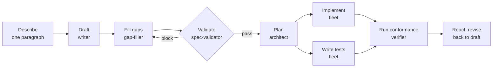

# Bootstrap lane: the first spec and the first build

The spike answered "would this be useful?". The bootstrap lane builds the first
spec and the first implementation. When the spec is approved as a baseline, the
project moves to evolution.

## The loop



| Step | Who | Output |
|---|---|---|
| Describe | user | a paragraph in `## Source` |
| Draft | `spec-writer` | `specs/system/<id>.md`, draft |
| Fill gaps | `gap-filler` | repo profile, assumptions, decisions, conflicts |
| Validate | `spec-validator` | `## Validation`, `status: validated` |
| Plan | `architect` | `plans/<id>.md` with file map, tracks, test strategy |
| Implement + write tests | `implementer` + `verifier` (fleet) | code and conformance tests, disjoint files |
| Run conformance | `verifier` | pass / fail / blocked per `REQ-` |

One paragraph in, one validated spec out. No interview, no approval meeting.

## What a spec looks like

Requirements are given/when/then, numbered, and sourced:

```md
### REQ-SYS-001: Shorten a valid URL

- **Priority:** must
- **Normative:** true
- **Source:** user
- **Given:** a user submits an absolute `http` or `https` URL
- **When:** they call the shorten endpoint
- **Then:** the response contains a short code that resolves to the same URL
```

Every guess is visible:

```md
## Assumptions

| # | Assumption | Basis | Risk | Confirmed | Revisit |
|---|---|---|---|---|---|
| 1 | Links are internal-only | no public sharing mentioned | medium | no | first feedback |
```

The full required sections, front-matter, and lifecycle are in
[`../SPEC.md`](../SPEC.md).

## Aggressive inference: one brake, one fence

The gap-filler may choose the stack, naming, structure, data shapes, defaults, and
POC simplifications. It records each choice with a basis, a risk, and a revisit
trigger. It does not ask "which database?" unless the answer changes something
expensive.

**One brake: conflicts.** A contradiction with an existing spec goes to
`## Conflicts` with options; the user chooses. An open conflict blocks validation.

**One fence: high-risk facts.** Security, privacy, data ownership/PII,
authentication, retention, pricing, legal, compliance, breaking contracts, and
irreversible migrations may be inferred for a POC, but they are fenced:
`Risk: high`, `Confirmed: agent (POC)`, `Revisit: before production`, fake data,
no real users, money, or PII. The validator reports them as warnings; they
do not block the POC, and they must be confirmed before promotion.

The inference ladder, record formats, and promotion steps are in
[`poc-mode.md`](poc-mode.md).

## The validation gate

There is no human approval step in the POC stage. The `spec-validator` agent
applies [`../checklists/validate.md`](../checklists/validate.md) and is the only
role allowed to set `status: validated`.

- The validator runs in a separate context and does not read the writer's
  rationale.
- It records a result per check, with findings at `file:line`.
- It binds the validation to a content hash (`validated_sha`). The hash excludes
  the marker-delimited validation block, so the record can change without
  invalidating the spec.
- Any semantic edit demotes the spec to `draft` and clears the hash.

That is a stricter gate than "looks good to me", without a meeting. It is not a
proof: it catches what the checklist can name, not whether the product is worth
building.

## Changing a draft

Bootstrap specs are editable:

1. Edit the spec.
2. Set `status: draft`.
3. Clear `validated_by`, `validated_at`, and `validated_sha`.
4. Re-run `/validate-spec`.
5. If a plan exists, it is now `stale`; re-run `/plan-implementation` before more
   code.

There is no version bump in the POC stage. `version` stays `0.1.0`; git is the
change log.

## Next

When the spec is validated, the architect turns it into a plan and the fleet
implements it: [`implementation.md`](implementation.md).

When the project is approved as a mature baseline, bootstrap is over; every
change uses [`change-mode.md`](../mature/docs/change-mode.md).
