# The specd workflow

One end-to-end view of the three lanes and the gates. The short version:

```text
spike:      hypothesis -> demo -> feedback -> kill | iterate | graduate
bootstrap:  describe -> draft -> gap-fill -> validate -> plan -> implement + tests -> conformance -> accept
evolution:  approved baseline -> CHG -> impact -> proposal -> validate -> review -> approvals
            -> release -> implement -> verify -> accept -> rollout
```

## The loop

```mermaid
flowchart TD
  U["User: one paragraph"] --> Q{"Need feedback first?"}
  Q -- yes --> S1["Spike: hypothesis + demo contract"]
  Q -- no --> B0
  S1 --> S2["Build one fake path"]
  S2 --> S3["Demo + three questions"]
  S3 --> SD{"Kill / iterate / graduate"}
  SD -- kill --> K["Archive branch; keep the spike log"]
  SD -- iterate --> S1
  SD -- graduate --> B0

  B0["Draft spec<br/>spec-writer"] --> B1["Gap-fill<br/>gap-filler"]
  B1 --> EX{"Open conflict or<br/>needs-human fact?"}
  EX -- yes --> HU["Human resolves or answers"]
  HU --> B1
  EX -- no --> B2{"Validate<br/>spec-validator"}
  B2 -- block --> B1
  B2 -- pass --> V["Validated POC spec<br/>validated_sha"]

  V --> P["Plan + context<br/>architect"]
  P --> I["Implement tracks<br/>implementer"]
  P --> T["Conformance + acceptance tests<br/>verifier"]
  I --> C{"Run conformance<br/>+ acceptance"}
  T --> C
  C -- code bug --> I
  C -- spec ambiguity --> B0
  C -- harness issue --> P
  C -- pass --> R["Use / react"]
  R --> HA{"Human accepts<br/>the outcome?"}
  HA -- no --> B0
  HA -- yes --> H1{"Promote?<br/>human approves baseline"}

  H1 -- no --> V
  H1 -- yes --> A["Approved baseline<br/>approved_sha, semver"]

  A --> CHG["CHG<br/>base_sha, proposal_sha"]
  CHG --> IMP["Impact + proposal<br/>change-analyst"]
  IMP --> PV{"Validate proposal<br/>spec-validator"}
  PV -- block --> IMP
  PV -- pass --> RV{"Review<br/>spec-reviewer"}
  RV --> AP{"Tiered approvals<br/>owner / consumers / security-data"}
  AP -- changes --> IMP
  AP -- approved --> REL["Human release<br/>apply body, bump version, approved_sha"]
  REL --> IMPL["Implement<br/>single track or plan + fleet"]
  IMPL --> VER["Verify<br/>regression + conformance + contracts"]
  VER --> RO["Rollout / rollback"]
  RO --> A
  REL -. retire / split .-> DEP["Deprecated / split<br/>result_status: deprecated"]

  classDef human fill:#fff3cd,stroke:#b7791f,color:#000
  classDef gate fill:#e8f5e9,stroke:#2f855a
  classDef artifact fill:#eef2ff,stroke:#4c51bf
  class HU,HA,H1,AP,REL human
  class Q,EX,B2,PV,RV,C gate
  class V,A,CHG artifact
```



**Amber** is a human decision. **Green** is an agent gate. **Blue** is an artifact.
The POC human inputs are `EX` (a conflict or reserved fact), `HA` (acceptance),
and `H1` (promotion). Everything else is the validator or the implementation loop.

## Loops

| Loop | Trigger | Goes back to |
|---|---|---|
| Gap-fill | A requirement has no source, or an assumption is unlabelled | `gap-filler` |
| Re-validation | A semantic edit or user feedback | `spec-writer` / draft; the plan becomes `stale` |
| Conformance | A code bug | `implementer` |
| Conformance | A spec ambiguity | `spec-writer` |
| Conformance | A harness issue | `architect` / plan |
| Acceptance | The user does not get the expected result | `spec-writer` / draft; the plan becomes `stale` |
| Proposal validation | A blocked effective spec | `change-analyst` |
| Review / approval | A required change to the proposal | `change-analyst` |
| Rollout | A failed canary or rollback | Previous baseline; human decision |

## Artifacts

| Artifact | Lives at | Bound by |
|---|---|---|
| Spike log | `spikes/<id>.md` | — |
| POC spec | `specs/system/<id>.md` | `validated_sha` once validated |
| Plan | `plans/<spec-id>.md` | `spec_sha` |
| Context pack | `.context/<id>.md` | The plan and target spec |
| Change | `changes/CHG-*.md` | `base_sha` and `proposal_sha` |
| Released change | `changes/archive/` | `released_as`, `released_at`, `released_by`, `release_commit` |
| Approved baseline | `specs/<kind>/<id>.md` | `approved_sha` |

## Acceptance is not conformance

A green validator and a green conformance suite only prove that the code matches
the spec. They do not prove the user accepts the result. `## Acceptance` is the
user-facing check; the `HA` node above is the human decision. Until that node is
yes, the application is not accepted, even if every `REQ-` test passes.

## Human guard

The full map is in [`../README.md#where-the-human-guard-is`](../README.md#where-the-human-guard-is).
In one line: no approval in the POC; a human resolves conflicts and reserved
facts, approves the first baseline, and releases mature changes after tiered
approval.

## Where to go next

- Bootstrap detail: [`bootstrap-mode.md`](bootstrap-mode.md)
- Mature lane: [`../mature/README.md`](../mature/README.md)
- Change detail: [`../mature/docs/change-mode.md`](../mature/docs/change-mode.md)
