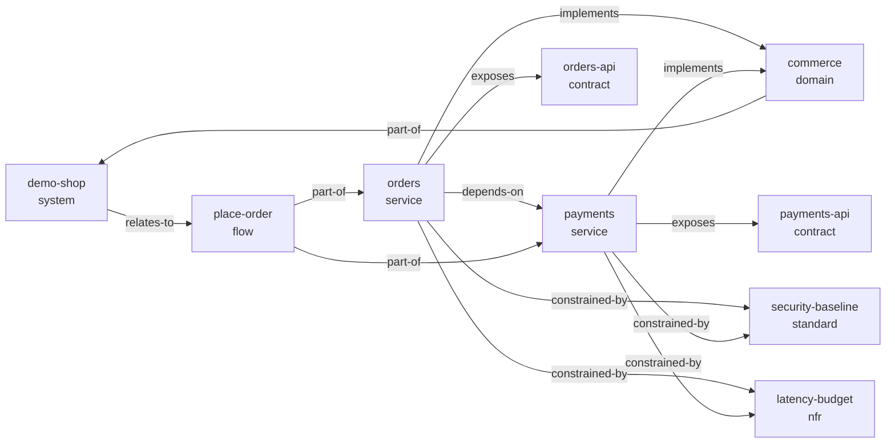

# Spec graph

This is a **view**, not the source of truth. The source of truth is the
front-matter and body of each spec. This copy is frozen with the legacy v1
example; do not update it.

## Demo graph

## Specs

| ID | Kind | Version | Status | Owner |
|---|---|---|---|---|
| `demo-shop` | system | 0.1.0 | draft | platform |
| `commerce` | domain | 0.1.0 | draft | platform |
| `orders` | service | 0.1.0 | draft | orders-team |
| `payments` | service | 0.1.0 | draft | payments-team |
| `orders-api` | contract | 0.1.0 | draft | orders-team |
| `payments-api` | contract | 0.1.0 | draft | payments-team |
| `place-order` | flow | 0.1.0 | draft | platform |
| `security-baseline` | standard | 1.0.0 | approved | security |
| `latency-budget` | nfr | 0.1.0 | draft | platform |
