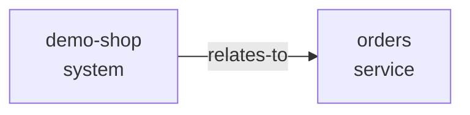

# Spec graph

> This is a **view**, not the source of truth. The source of truth is each spec's
> front-matter and body. Update the view when a spec is added, validated, promoted,
> released, or deprecated; if it is stale, say so.

## Graph

## Specs

| ID | Kind | Version | Status | Owner |
|---|---|---|---|---|
| `<id>` | `service` | `1.0.0` | `approved` | `<owner>` |
